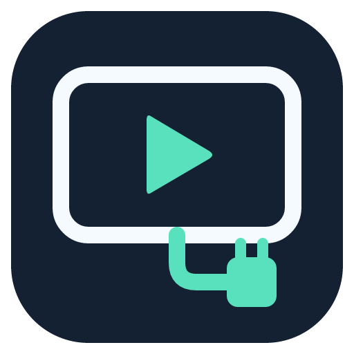

# USB Capture Viewer

## [Download Windows app — ready-to-run ZIP](https://github.com/gbaba86/usb-capture-viewer/releases/download/v1.0.0-beta.2/USB-Capture-Viewer-v1.0.0-beta.2-win-x64.zip)

1. Download the **Windows ZIP** using the link above.
2. Extract **all** files, then open the `USB-Capture-Viewer` folder.
3. Double-click **USBCaptureViewer.exe**.

**Code → Download ZIP** and **Source code** downloads are for developers; they contain source, not the ready-to-run EXE. Keep the DLLs and `libvlc` folder beside the app.



A small Windows app for playing a console through a USB HDMI capture card, with live video and audio. No OBS setup, streaming, or recording.

**Experimental preview.** Physically tested with **Nintendo Switch 2 + AVerMedia Live Gamer MINI (GC311)**. The tester found the improved video/audio playable but could still feel some delay. Other capture cards and consoles are not certified. This is an independent project, not an official Nintendo, AVerMedia, Microsoft, or VideoLAN product.

[ภาษาไทย](README.th.md) · [English user guide](docs/USER_GUIDE.en.md) · [คู่มือภาษาไทย](docs/USER_GUIDE.th.md) · [Downloads](https://github.com/gbaba86/usb-capture-viewer/releases/tag/v1.0.0-beta.2)

## Download and run

1. Download **USB-Capture-Viewer-v1.0.0-beta.2-win-x64.zip** from [Releases](https://github.com/gbaba86/usb-capture-viewer/releases/tag/v1.0.0-beta.2).
2. Extract **the entire ZIP** to a folder. Keep all its files together.
3. Connect console/dock **HDMI → capture card HDMI IN**, then capture card **USB → PC**. HDMI OUT is optional, depending on the card.
4. Open **USBCaptureViewer.exe**. The saved device, or a detected Live Gamer MINI on first use, connects automatically.
5. For another card, choose its video and audio inputs once. They can be separate devices. The app remembers them; it does not guess a personal webcam or microphone as a replacement.

Windows x64 is required. The release is self-contained with .NET 10 and the native media libraries; no separate .NET, Python, VLC, or OBS installation is needed. The local test machine ran Windows 10 Pro 22H2; this does not certify operating-system security support. Use a currently supported Windows x64 release (Windows 11 recommended); Windows 10 support depends on the applicable Microsoft servicing/ESU arrangements. The executable is **not Authenticode signed**. Do not disable Windows security to run it. Verify the [SHA-256 checksums](https://github.com/gbaba86/usb-capture-viewer/releases/download/v1.0.0-beta.2/SHA256SUMS.txt) and decide whether you trust this experimental build.

## Controls

The current app labels are Thai; both guides include the corresponding English meanings.

| Control | Action |
| --- | --- |
| **F11** / เต็มจอ | Toggle fullscreen; hide all app controls |
| **Esc** | Leave fullscreen |
| **Tab** / ซ่อนเมนู / แสดงเมนู | Collapse/show the side menu when focus is outside device lists |
| **M** / ปิดเสียง | Mute/unmute when focus is outside device lists |
| Volume slider | Set this app's audio level |
| ตั้งค่าภาพ / เสียง | Advanced capture settings; preview pauses, then reconnects |
| เชื่อมต่อใหม่ | Retry connection |
| Close window | Release video and audio devices |

## What is included

- Auto-connect the saved capture inputs; remember mode, volume, mute and menu state.
- Inspect driver-advertised resolution/FPS/pixel-format combinations, or use Auto.
- Common SDR capture modes up to 1920×1080/60 FPS; 16:9 display with letterboxing.
- DirectShow/LibVLC video and separate WASAPI shared-mode audio through NAudio.
- Bounded audio queues, late-video-frame dropping and reconnect backoff.
- No streaming, recording, accounts, app telemetry or automatic uploads.

For **GC311 + Switch 2**, start with **1080p60 SDR**, HDR and 120 Hz output off, and Stereo sound on the console. The tested app mode is **1920×1080 / 60 FPS / MJPG**, with **50 ms video cache**. The app cannot change console HDMI output settings.

**50 ms is a configured video buffer, not measured end-to-end latency.** Audio uses a separate path; it is not delayed to follow the video clock. Hardware, USB, drivers, display and Windows audio buffering still add latency. Zero latency is not promised. See [testing and limitations](docs/TESTING.md).

## Build from source

Install the **.NET 10 SDK on Windows x64**, then run from PowerShell in this checkout:

```powershell
.\build.ps1
```

The script downloads a pinned official VLC 3.0.24 archive, verifies SHA-256, restores locked NuGet dependencies and produces `publish/`. It does not install drivers or change global settings. The public build omits debug symbols and maps source paths to a neutral prefix. See [BUILDING.md](docs/BUILDING.md).

## Privacy, licensing and reporting

Settings and bounded diagnostic logs stay under `%LOCALAPPDATA%\SwitchCaptureViewer`. They may contain device names, device identifiers and local paths. **Do not post them publicly without reviewing/redacting them.** The public downloads contain no tester settings, logs, captures, desktop shortcuts or local debug symbols. See [privacy notes](docs/PRIVACY.md).

Application source: **GPL-2.0-or-later**; see [LICENSE](LICENSE). Bundled libraries have their own GPL/LGPL/MIT and other notices. The Release provides corresponding-source archives alongside the Windows binary; see [third-party notices](THIRD_PARTY_NOTICES.md). Retain these materials when redistributing. No DRM prevents replacing compatible dynamic libraries.

For a bug report, use [Issues](https://github.com/gbaba86/usb-capture-viewer/issues) with the app version, Windows version, capture-card model and steps. Avoid personal information or captured audio/video. See [SECURITY.md](SECURITY.md) before reporting a sensitive issue.


Hardware feedback refers to the earlier local baseline; the public .NET 10 runtime upgrade was rechecked with synthetic video/audio, without a new hardware capture session.
