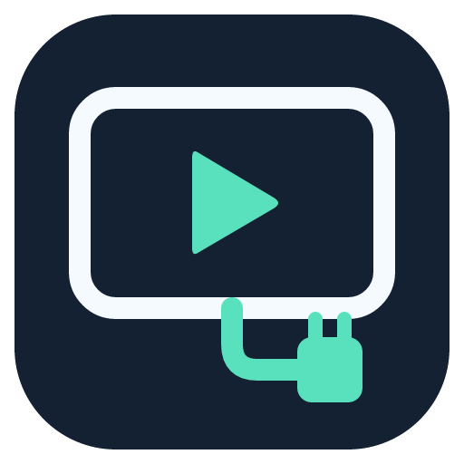

# USB Capture Viewer

## [ดาวน์โหลดแอป Windows — ZIP พร้อมใช้](https://github.com/gbaba86/usb-capture-viewer/releases/download/v1.0.0-beta.2/USB-Capture-Viewer-v1.0.0-beta.2-win-x64.zip)

1. ดาวน์โหลด **Windows ZIP** จากลิงก์ด้านบน
2. แตก ZIP **ทั้งหมด** แล้วเปิดโฟลเดอร์ `USB-Capture-Viewer`
3. ดับเบิลคลิก **USBCaptureViewer.exe**

**Code → Download ZIP** และ **Source code** เป็นซอร์สสำหรับนักพัฒนา ไม่มี EXE พร้อมใช้ ให้เก็บ DLL และโฟลเดอร์ `libvlc` ไว้ข้างตัวแอปทั้งหมด



แอป Windows ขนาดเล็กสำหรับเล่นเครื่องเกมผ่านการ์ดแคปเจอร์ HDMI แบบ USB พร้อมภาพและเสียง ไม่ต้องตั้งค่า OBS ไม่มีสตรีมหรือบันทึกวิดีโอ

**รุ่นทดลอง** ทดสอบกับ **Nintendo Switch 2 + AVerMedia Live Gamer MINI (GC311)** จริง ผู้ทดสอบยืนยันว่าหลังปรับปรุงแล้วภาพและเสียงพอเล่นได้ แต่ยังสัมผัสความหน่วงได้บ้าง ยังไม่รับรองการ์ดหรือเครื่องเกมทุกตัว เป็นโครงการอิสระ ไม่ใช่ผลิตภัณฑ์ทางการของ Nintendo, AVerMedia, Microsoft หรือ VideoLAN

[English](README.md) · [คู่มือภาษาไทย](docs/USER_GUIDE.th.md) · [English user guide](docs/USER_GUIDE.en.md) · [ดาวน์โหลด](https://github.com/gbaba86/usb-capture-viewer/releases/tag/v1.0.0-beta.2)

## ดาวน์โหลดและเปิดใช้

1. ดาวน์โหลด **USB-Capture-Viewer-v1.0.0-beta.2-win-x64.zip** จาก [Releases](https://github.com/gbaba86/usb-capture-viewer/releases/tag/v1.0.0-beta.2)
2. แตก ZIP **ทั้งหมด** ไปในโฟลเดอร์ เก็บไฟล์และโฟลเดอร์ย่อยไว้ด้วยกัน
3. ต่อ **HDMI จากเครื่องเกม/ด็อก → HDMI IN ของการ์ด** แล้วต่อ **USB ของการ์ด → คอม** ส่วน HDMI OUT เป็นทางเลือกตามการ์ด
4. เปิด **USBCaptureViewer.exe** โปรแกรมจะเชื่อมต่ออุปกรณ์ที่จำไว้ หรือ Live Gamer MINI ที่ตรวจพบในการใช้ครั้งแรกเอง
5. การ์ดอื่นให้เลือกอุปกรณ์ภาพและเสียงครั้งแรก ทั้งสองอาจเป็นคนละอุปกรณ์ โปรแกรมจะจำค่า และไม่เดาเปิดเว็บแคมหรือไมโครโฟนส่วนตัวแทน

ต้องใช้ Windows x64 ชุดดาวน์โหลดรวม .NET 10 และไลบรารีวิดีโอไว้แล้ว ไม่ต้องติดตั้ง .NET, Python, VLC หรือ OBS แยก เครื่องทดสอบเป็น Windows 10 Pro 22H2 ไม่ถือเป็นการรับรองระยะสนับสนุนความปลอดภัยของระบบ ควรใช้ Windows x64 ที่ยังได้รับการสนับสนุน (แนะนำ Windows 11) ส่วน Windows 10 ขึ้นกับเงื่อนไข servicing/ESU ของ Microsoft ไฟล์ EXE **ไม่ได้ลงนาม Authenticode** อย่าปิดระบบความปลอดภัยของ Windows เพื่อเปิดแอป ตรวจ [SHA-256](https://github.com/gbaba86/usb-capture-viewer/releases/download/v1.0.0-beta.2/SHA256SUMS.txt) และตัดสินใจว่าคุณเชื่อถือรุ่นทดลองนี้หรือไม่

## ปุ่มควบคุม

ข้อความบนแอปรุ่นปัจจุบันเป็นภาษาไทย คู่มือทั้งสองภาษาระบุความหมายตรงกัน

| ปุ่ม | การทำงาน |
| --- | --- |
| **F11** / เต็มจอ | เข้า/ออกเต็มจอ ซ่อนแถบควบคุมทั้งหมด |
| **Esc** | ออกจากเต็มจอ |
| **Tab** / ซ่อนเมนู / แสดงเมนู | พับ/เปิดเมนูด้านข้าง เมื่อไม่ได้โฟกัสรายการอุปกรณ์ |
| **M** / ปิดเสียง | ปิด/เปิดเสียง เมื่อไม่ได้โฟกัสรายการอุปกรณ์ |
| แถบระดับเสียง | ปรับเสียงของแอป |
| ตั้งค่าภาพ / เสียง | ตั้งค่าเพิ่มเติม พรีวิวจะพักแล้วเชื่อมต่อใหม่ |
| เชื่อมต่อใหม่ | ลองเชื่อมต่ออีกครั้ง |
| ปิดหน้าต่าง | คืนอุปกรณ์ภาพและเสียง |

## ความสามารถ

- เชื่อมต่ออุปกรณ์ที่จำไว้เอง จำโหมดภาพ ระดับเสียง ปิดเสียงและสถานะเมนู
- อ่านชุดความละเอียด/FPS/pixel format ที่ไดรเวอร์รายงาน หรือใช้ Auto
- โหมด SDR ทั่วไปไม่เกิน 1920×1080/60 FPS แสดงภาพ 16:9 พร้อมขอบดำตามพื้นที่
- ภาพผ่าน DirectShow/LibVLC และเสียงแยกผ่าน WASAPI shared ด้วย NAudio
- จำกัดคิวเสียง ทิ้งเฟรมภาพที่ช้า และเว้นระยะการลองเชื่อมต่อใหม่
- ไม่มีสตรีม บันทึกวิดีโอ บัญชีผู้ใช้ telemetry ของแอป หรืออัปโหลดอัตโนมัติ

สำหรับ **GC311 + Switch 2** เริ่มที่ **1080p60 SDR**, ปิด HDR และ 120 Hz ที่เครื่องเกม และเลือกเสียง Stereo ค่ารับภาพที่ทดสอบคือ **1920×1080 / 60 FPS / MJPG**, บัฟเฟอร์ภาพ **50 ms** แอปเปลี่ยน HDMI output ของเครื่องเกมไม่ได้

**50 ms คือค่าบัฟเฟอร์ภาพ ไม่ใช่ latency รวมที่วัดได้** เสียงใช้ทางแยกและไม่ได้เพิ่มดีเลย์เพื่อตามภาพ ยังมีความหน่วงจากการ์ด USB ไดรเวอร์ จอและระบบเสียง Windows ไม่รับประกัน zero latency ดู [ผลทดสอบและข้อจำกัด](docs/TESTING.md)

## Build จาก source

ติดตั้ง **.NET 10 SDK บน Windows x64** แล้วเปิด PowerShell ใน checkout นี้และรัน:

```powershell
.\build.ps1
```

สคริปต์ดาวน์โหลด VLC 3.0.24 ทางการที่ตรึงรุ่น ตรวจ SHA-256 ใช้ NuGet lock file และสร้างชุดใน `publish/` ไม่ติดตั้งไดรเวอร์หรือเปลี่ยนค่าระบบ global ชุดเผยแพร่ไม่รวม debug symbols และใช้ source path กลาง ดู [BUILDING.md](docs/BUILDING.md)

## ความเป็นส่วนตัว สิทธิ์ใช้งานและแจ้งปัญหา

ค่าที่จำไว้และ log แบบจำกัดขนาดอยู่ใน `%LOCALAPPDATA%\SwitchCaptureViewer` อาจมีชื่ออุปกรณ์ ตัวระบุอุปกรณ์และ path ในเครื่อง **ตรวจและลบข้อมูลส่วนตัวก่อนโพสต์สาธารณะ** ชุดดาวน์โหลดไม่รวมค่าของผู้ทดสอบ log ภาพ/เสียงที่แคปเจอร์ shortcut Desktop หรือ debug symbols จากเครื่อง ดู [ข้อมูลความเป็นส่วนตัว](docs/PRIVACY.md)

Source แอปใช้ **GPL-2.0-or-later** ดู [LICENSE](LICENSE) ไลบรารีที่รวมมามี GPL/LGPL/MIT และ notices ของตนเอง Release มี corresponding-source archives คู่กับชุด Windows ดู [third-party notices](THIRD_PARTY_NOTICES.md) เก็บข้อมูลสิทธิ์เหล่านี้เมื่อแจกต่อ สามารถเปลี่ยนไลบรารี dynamic เป็นรุ่นดัดแปลงที่เข้ากันได้โดยไม่มี DRM ขัดขวาง

แจ้งบั๊กผ่าน [Issues](https://github.com/gbaba86/usb-capture-viewer/issues) พร้อมเวอร์ชันแอป Windows รุ่นการ์ดและขั้นตอน หลีกเลี่ยงข้อมูลส่วนตัวหรือภาพ/เสียงแคปเจอร์ อ่าน [SECURITY.md](SECURITY.md) ก่อนแจ้งปัญหาอ่อนไหว


ผลจากฮาร์ดแวร์อ้างอิง baseline ในเครื่องก่อนอัปเกรด ส่วนชุด public ที่ย้ายมา .NET 10 ตรวจซ้ำด้วยภาพ/เสียงสังเคราะห์ โดยไม่ได้เปิด capture ฮาร์ดแวร์รอบใหม่
